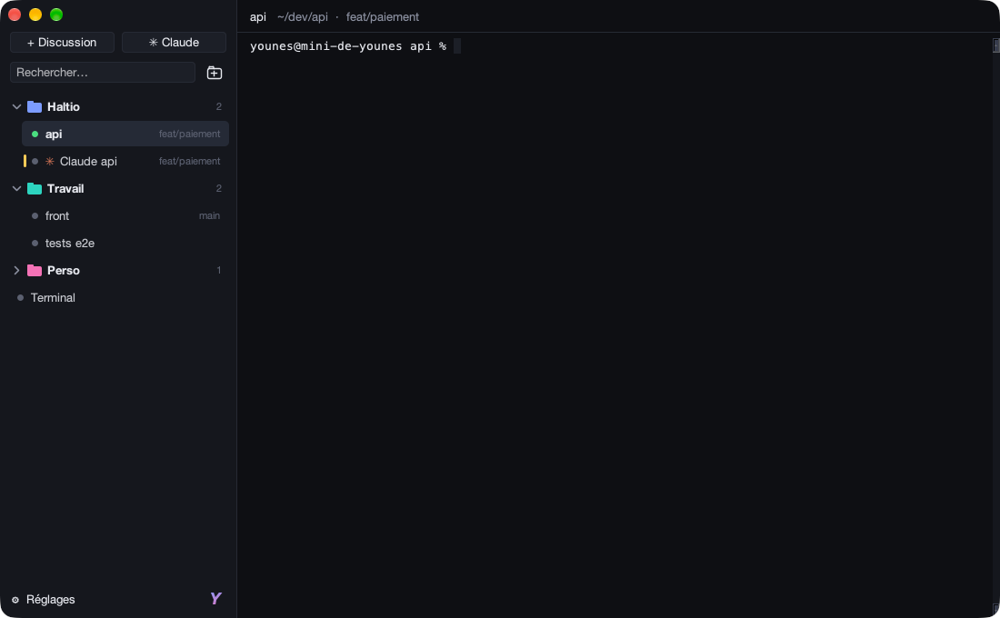

<p align="center"></p>

# Younesh (Java)

Version Java de [Younesh](https://github.com/jonasmelheb/younesh) : un terminal qui range les discussions dans une barre latérale, en dossiers colorés. Un seul fichier `.jar`, qui tourne partout où Java 17+ est installé (Windows, macOS, Linux).



## Lancer

1. Télécharger `Younesh-x.y.z.jar` depuis les [Releases](https://github.com/jonasmelheb/younesh-java/releases).
2. `java -jar Younesh-x.y.z.jar` (ou double-clic si les `.jar` sont associés à Java).

Vérifier la version de Java : `java -version` (17 ou plus).

## Ce qu'il y a dedans

- **Discussions dans la barre latérale**, rangées en **dossiers colorés** (palette ou couleur personnalisée), repliables, avec glisser-déposer pour déplacer et réordonner.
- **Shells détectés** : PowerShell 7, Windows PowerShell, Invite de commandes, Git Bash, WSL (zsh/bash sur macOS). Vrai pseudo-terminal (ConPTY sous Windows) grâce à pty4j.
- **Sessions Claude Code** : le bouton ✳ Claude lance `claude` dans le répertoire choisi ; la conversation reprend au prochain lancement.
- **Claude attend** : la discussion passe en orange quand Claude se tait après avoir répondu (et sur la cloche du terminal), avec notification.
- **Branche git** de chaque discussion, lue directement dans `.git`.
- **Palette rapide** (Ctrl+Shift+P), recherche dans la barre latérale (sans accents).
- **Thèmes** Sombre, Minuit, Graphite, Clair ; police, taille, historique, shell et répertoire par défaut.
- Points d'état : vert = en cours, bleu = nouvelle sortie, rouge = terminé, gris = pas démarré.
- Tout est enregistré dans `%APPDATA%\younesh-java\younesh.json` (`~/.younesh-java` ailleurs).

Pas encore porté depuis la version Electron : sandboxes sbx, côte à côte, recherche dans le terminal, restauration du contenu, import/export.

## Raccourcis

| Action | Touches |
| --- | --- |
| Palette rapide | Ctrl+Shift+P |
| Nouvelle discussion | Ctrl+Shift+T |
| Nouvelle session Claude | Ctrl+Shift+N |
| Nouveau dossier | Ctrl+Shift+D |
| Discussion suivante / précédente | Ctrl+Tab / Ctrl+Shift+Tab |
| Fermer la discussion | Ctrl+Shift+W |
| Renommer | F2 |
| Aller à la discussion qui attend | Ctrl+Shift+U |
| Afficher / masquer la barre latérale | Ctrl+Shift+B |
| Nouvelle ligne dans Claude | Shift+Entrée |

Clic droit sur une discussion ou un dossier pour toutes les options, double-clic pour renommer, clic molette pour fermer.

## Développement

```bash
mvn package                 # construit target/Younesh.jar
java -jar target/Younesh.jar
```

Chaque tag `v*` construit le jar sur GitHub Actions et le publie dans une Release ([workflow](.github/workflows/build.yml)).

Construit avec Swing, [FlatLaf](https://www.formdev.com/flatlaf/), [JediTerm](https://github.com/JetBrains/jediterm) et [pty4j](https://github.com/JetBrains/pty4j).

## Licence

[MIT](LICENSE)

---

<p align="right"><em>Made by Y</em></p>
